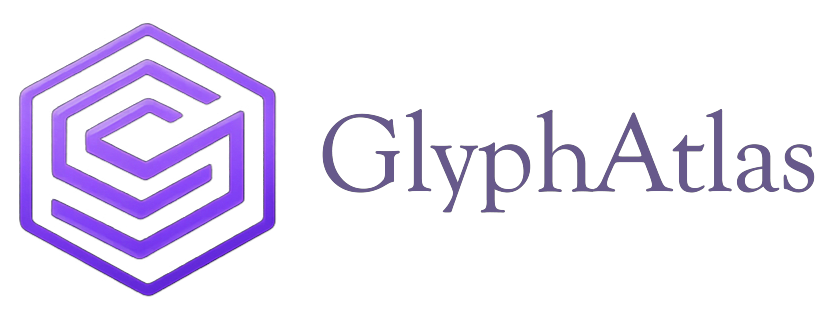
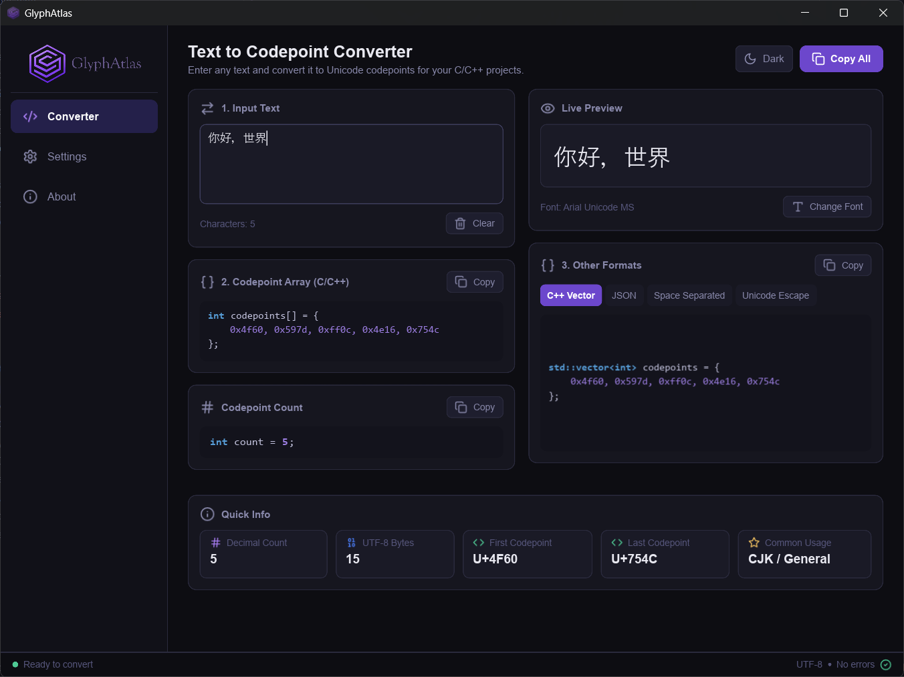

<div align="center">
  

# GlyphAtlas

  **Unicode to Codepoint Converter — Made simple.**

  
  
  
  
  

</div>

---

## The Problem

If you have ever worked with **non-Latin characters** in a native C/C++ project — Chinese, Arabic, Tamil, Cyrillic, or any other script — you know the frustration.

Every time you need a character, you have to search online to find its Unicode value. Most tools give you something like this:

```
\u4f60\u597d\u4e16\u754c
```

That's `你好世界`. But that format is useless on its own. To actually use it in C/C++, you need it formatted as:

```c
int codepoints[] = { 0x4f60, 0x597d, 0x4e16, 0x754c };
int count = 4;
```

Reformatting that by hand, every single time, is a hassle that adds up fast.

**Asking AI?** Sure, but that burns tokens for something that should be instant, offline, and free.

### The Raylib Angle

This problem hits especially hard when using **[raylib](https://www.raylib.com/)**. Raylib has limited UTF-8 support out of the box, and the **only reliable way to render non-Latin glyphs** is to load their codepoints explicitly at font load time using `LoadFontEx`. Without the right codepoint array, your characters simply won't render.

---

## The Idea

> *"What if there was a small, blazing-fast native tool that takes your characters and spits out a ready-to-use codepoint array with a count — no reformatting, no searching, no AI tokens wasted?"*

That question started GlyphAtlas. Originally built in Python, GlyphAtlas has been completely re-engineered as a **native C++20 and Slint desktop application**, delivering instant startup, zero runtime dependencies, and native GPU rendering.

---

## Features

- **Blazing Fast Native Core** — Standalone C++20 Unicode engine with zero overhead and live updates as you type.
- **C/C++ Array Output** — `int codepoints[] = { 0x... };` ready to copy directly into your source files.
- **Multiple Output Formats** — C++ Vector (`std::vector<int>`), JSON array, space-separated hex, and Unicode escape (`U+...`).
- **Codepoint Count Statement** — `int count = N;` automatically computed.
- **Full Unicode Coverage** — Handles CJK, Tamil, Arabic, Greek, Cyrillic, combining characters, and supplementary plane characters (including emoji like `🎉`, `🚀`).
- **Live Glyph Preview** — Inspect glyphs at large size with live font cycling (`Microsoft YaHei`, `Segoe UI`, `SimSun`, `SimHei`, etc.).
- **Quick Info Panel** — Live decimal count, UTF-8 byte length, first/last codepoint, and automatic script classification.
- **One-Click Clipboard Actions** — Copy individual code blocks or use **Copy All** to export every format in one go.
- **Theme Switching** — Instant toggle between dark and light themes.
- **Configurable Hex Options** — Toggle Latin inclusion, `0x` hex prefixes, and uppercase hexadecimal output.

---

## Screenshot



---

## Building from Source

### Prerequisites

- **CMake** (version 3.21 or later)
- **C++20 Compiler** (Clang, MSVC, or GCC)
- **Rust Toolchain** (required by Slint's C++ integration)
- **Ninja** or another CMake generator

### Build Steps

```bash
# 1. Clone repository
git clone https://github.com/vk22006/glyph-atlas.git
cd glyph-atlas

# 2. Configure build with CMake
cmake -B build -G Ninja -DCMAKE_BUILD_TYPE=Release

# 3. Compile executable and unit tests
cmake --build build --config Release
```

The resulting executable will be located at:
`build/GlyphAtlas.exe` (with `slint_cpp.dll` automatically copied beside it).

### Running Unit Tests

GlyphAtlas includes unit tests verifying Unicode extraction, Latin filtering, formatting, byte counting, and script classification:

```bash
ctest --test-dir build --output-on-failure
```

Or execute the test binary directly:

```bash
./build/test_unicode_core.exe
```

---

## Standalone Deployment & Packaging

GlyphAtlas is completely self-contained. All icons, assets, and UI components are compiled directly into the binary.

To deploy or distribute a release bundle, only two files are required:

```
GlyphAtlas/
├── GlyphAtlas.exe    # Native executable with embedded icon and UI assets
└── slint_cpp.dll     # Slint C++ runtime library
```

No external runtime environments (e.g. Python, Python virtual environments, or system frameworks) are needed.

---

## Contributing

Please see [CONTRIBUTING.md](CONTRIBUTING.md) for details on submitting bug fixes, performance improvements, and documentation updates.

---

## License

This project is licensed under the MIT License. See [LICENSE](LICENSE) for details.
